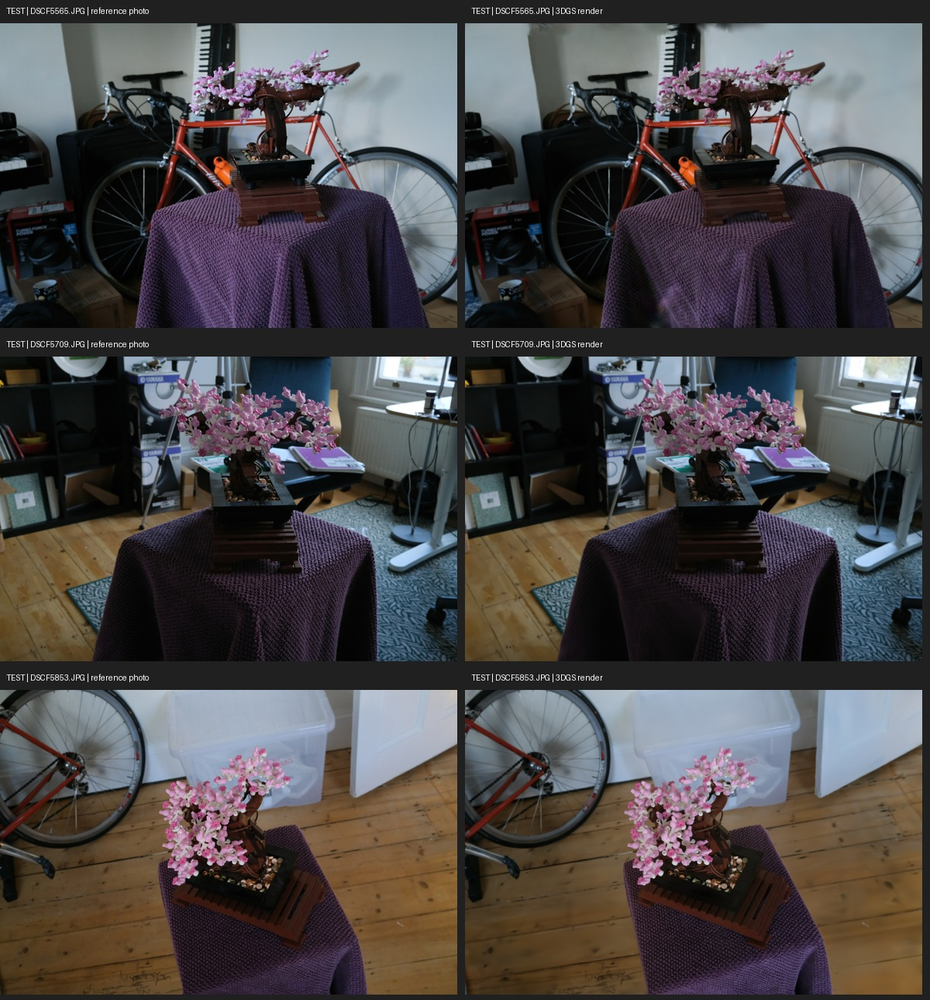
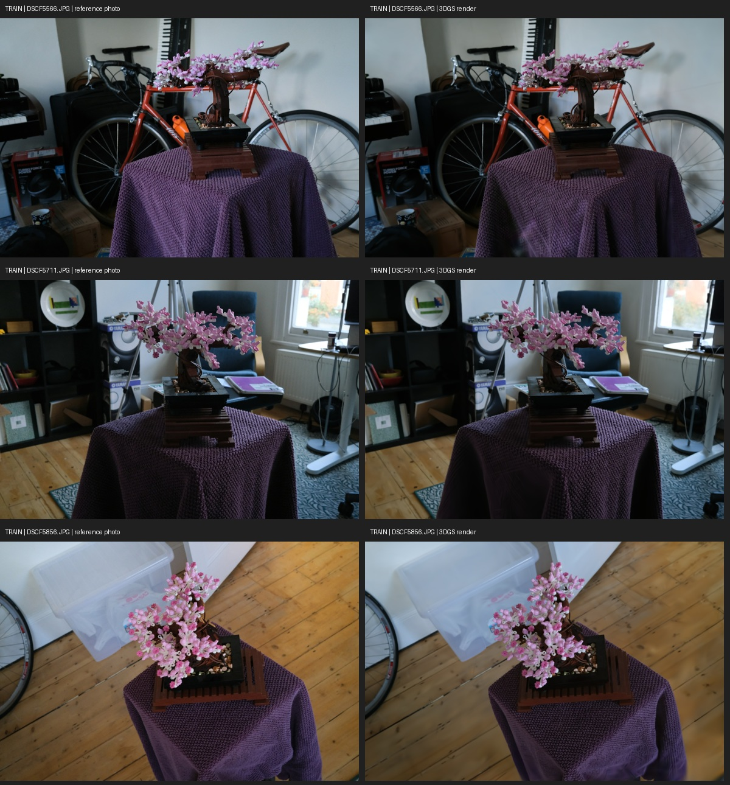
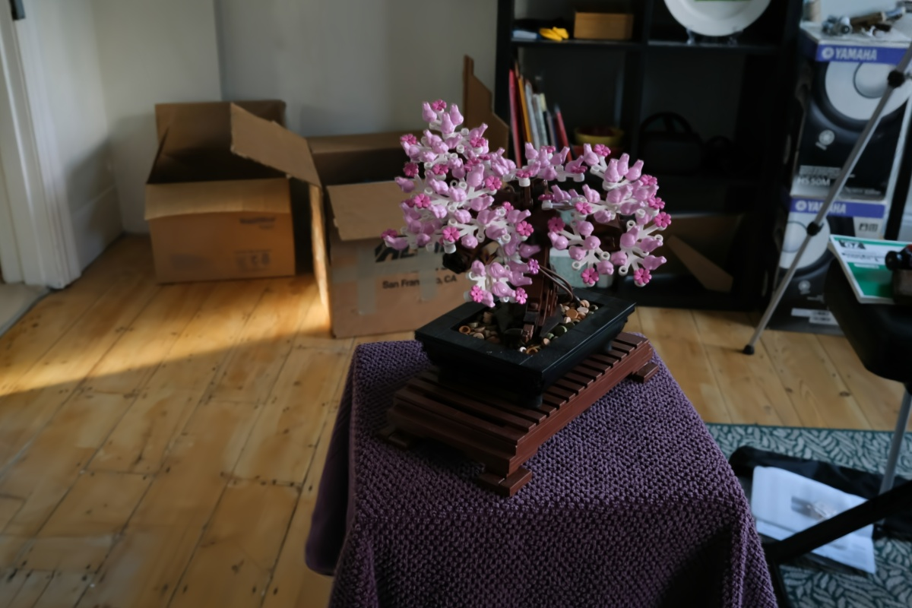

# Original 3D Gaussian Splatting on Mip-NeRF 360 Bonsai

A reproducible single-scene run of the original GraphDeco 3D Gaussian Splatting implementation on the public **Bonsai** scene from Mip-NeRF 360. Upstream training code is unchanged at commit `54c035f7834b564019656c3e3fcc3646292f727d`.

## Results

| Measurement | Result |
|---|---:|
| Input photographs | 292 |
| Training / held-out test views | 255 / 37 |
| Training iterations | 30,000 |
| Mean held-out PSNR | 32.1281 dB |
| Mean held-out SSIM | 0.9419 |
| Gaussian count | 1,073,930 |
| Original model PLY | 266,336,172 bytes (254.0 MiB) |
| Training elapsed | 2,929.75 s (48.83 min) |
| Training GPU | NVIDIA H20, device 4 |
| Sampled training GPU-memory peak | 4,740 MiB, sampled every 3 s |
| Median render time | 18.08 ms/frame on H20 |
| Render-time PyTorch allocated-memory peak | 807.5 MiB |

The sampled memory value can miss short-lived peaks. Rendering time excludes CPU transfer, video encoding, and browser/viewer overhead. These are measurements from an H20 server, not an RTX 5070 benchmark. Per-view PSNR/SSIM and exact train/test file lists are in [metrics.json](results/metrics.json).

### Held-out views

### Training views

### Novel-view rendering

[Open or download the 132-frame novel-view video](results/novel_views.mp4).

## Interactive model and downloadable weights

The standalone browser viewer and both model exports are attached to the [Bonsai 3DGS release](https://github.com/zzzhang1127/3dgs-mipnerf360-bonsai/releases/tag/bonsai-2026-10-27):

- `bonsai_original.ply`: original trained Gaussian PLY.
- `bonsai_compressed.ply`: delivery-optimized compressed PLY.
- `bonsai_interactive_viewer.zip`: single-file viewer, compressed scene, preview images, video, metrics, and license notices.

The viewer was exported with PlayCanvas's official SuperSplat Viewer package; this repository does not claim it as a custom-built viewer. Extract the ZIP and open `bonsai_viewer.html` in a recent desktop browser.

## Dataset and split

We use the **Bonsai** scene from [Mip-NeRF 360](https://jonbarron.info/mipnerf360/). For reproducible downloads, [data_manifest.json](data_manifest.json) pins a public Hugging Face mirror revision and records every file's size and SHA-256. The downloader writes to `data/bonsai/` and verifies each file:

~~~bash
python -m pip install -r requirements.txt
HF_ENDPOINT=https://hf-mirror.com python scripts/download_bonsai.py
~~~

The manifest covers 295 image/COLMAP files (372,967,249 bytes); 292 are camera views. Raw dataset files are not stored in this Git repository. The split follows the standard every-eighth-view evaluation protocol: 255 views for training and 37 held out for test. Training and test names are disjoint. COLMAP calibration and sparse points are used for both sets; held-out photographs are not optimization targets.

## Reproduce the run

Tested on Ubuntu Linux, Python 3.12.13, CUDA 12.4 toolkit/driver, PyTorch 2.4.0+cu118, and an NVIDIA H20. See [ENVIRONMENT.md](ENVIRONMENT.md) for runtime pins and extension build notes.

~~~bash
bash scripts/setup_environment.sh
HF_ENDPOINT=https://hf-mirror.com python scripts/download_bonsai.py
bash scripts/train_bonsai.sh
bash scripts/render_test.sh
~~~

The training command uses the upstream defaults except for the recorded evaluation settings: `images_2`, resolution scale 1, CPU-side dataset cache, 30,000 iterations, test/save at 7,000 and 30,000, and the standard evaluation split. It uses default Adam, spherical-harmonics degree 3, no depth supervision, and no antialiasing.

Training outputs go to ignored `output/bonsai/`. Run the scripts from the repository root. Choose an available CUDA device with `CUDA_VISIBLE_DEVICES` before launching.

## Repository layout

- `scripts/`: data download/verification, pinned upstream setup, training, and test rendering.
- `results/`: visual results, metrics, and video.
- `data_manifest.json`: pinned public file list and integrity hashes.
- GitHub Release: trained PLY files and interactive viewer bundle.

## Licenses

Repository-authored scripts and documentation are MIT licensed. The GraphDeco implementation and trained model are subject to the included [GraphDeco license](LICENSES/GRAPHDECO-LICENSE.md), which limits use to research/evaluation and prohibits commercial use without prior explicit permission. Viewer bundle notices are included separately. The raw dataset is not redistributed here; see [ATTRIBUTION.md](ATTRIBUTION.md) for sources and terms.
